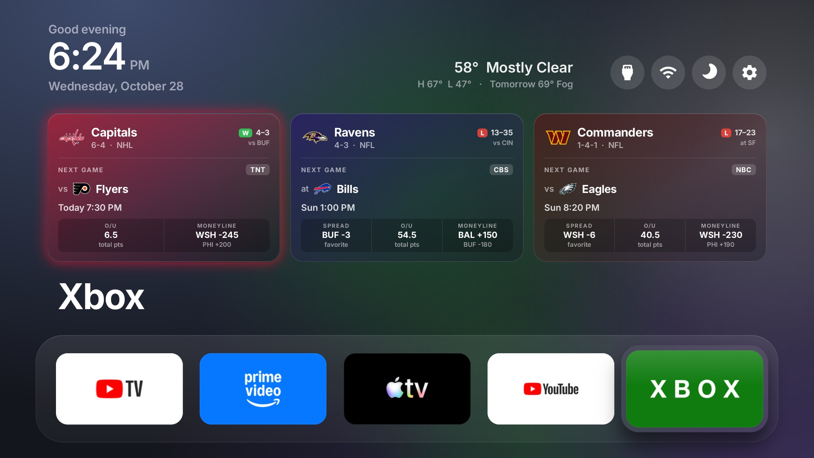
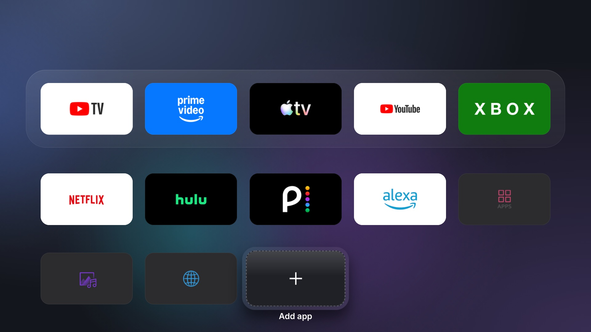
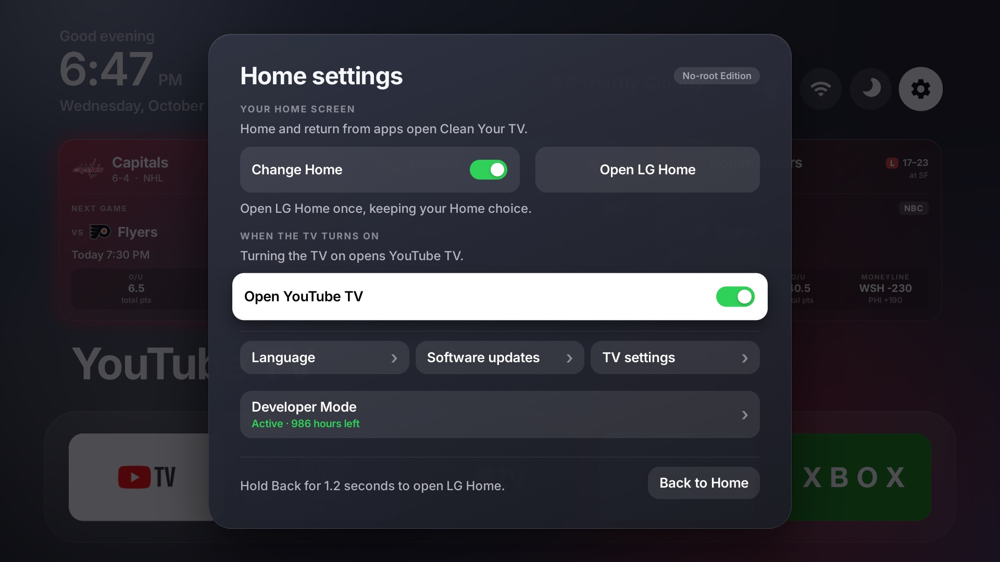
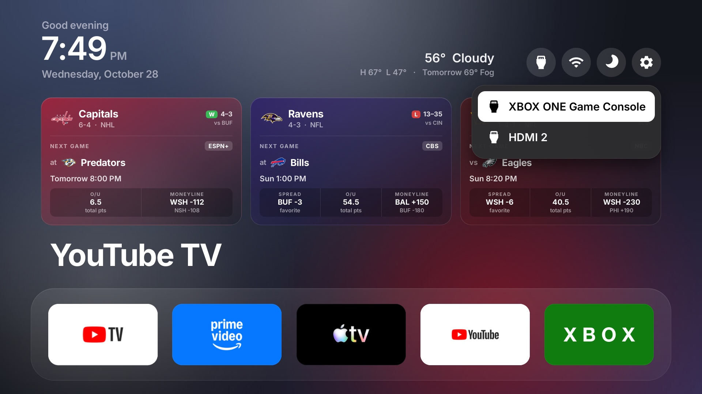
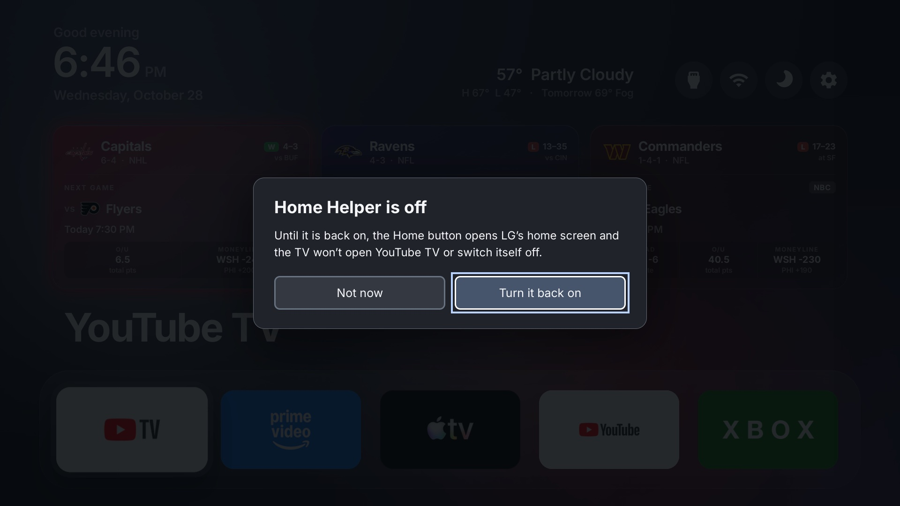

# LG TV Clean Home

An Apple TV–style home screen for LG webOS TVs. It replaces LG's ad-filled Home with a clean dock,
your own app grid, live weather and score cards. A small helper app keeps you there: the Home
button, the power button and every app exit come back to this screen, never LG's.

Built and tested on an **LG 65UQ8000AUB** (webOS TV Lite 7.6.0, webOS 22). It's a personal fork of
[Clean Your TV — LG webOS](https://github.com/Razdva122/clean-your-tv-lg-webos) by Razdva122
(No-root edition). No root and no firmware changes: everything installs as two Developer Mode
apps, so a factory reset always puts the TV back exactly as it shipped.



*Real screenshots, captured from the TV on 28 Oct 2026.*

## Top features

- **No ads, no LG clutter.** A dock of five favourite apps and a grid of everything else, in your
  order, with the apps you never use hidden.
- **LG's home screen stays away.** The Home button and every app exit come back here. The only way
  to reach LG's home screen is to press Home **5 times within 2 seconds** (or choose **Open LG
  Home** in Settings).
- **No LG screensaver, ever.** It's turned away whenever it tries to appear.
- **Opens YouTube TV when you turn the TV on**, with a switch in Settings to open Home instead.
- **Live score cards** for your teams: next game, time and channel, live score, last result and the
  betting lines. The card glows in team colours on game day.
- **Weather in the corner**: now, today's high and low, tomorrow, and National Weather Service
  warnings.
- **Good night button**: the TV turns itself off in 30 minutes. It also turns off after 5 hours
  without a button press, with a warning a minute before.
- **Looks after itself.** It keeps LG's Developer Mode renewed, so the apps never expire. It also
  restarts itself if the TV pauses it.
- **One press to recover.** If the helper is ever off, Home says so and offers **Turn it back on**,
  already selected, so one OK fixes it.
- **Fast.** Moving between tiles runs at 51–56 fps, against 9 fps before tuning. Home is ready in
  0.1–0.6 s.

## Screenshots

| | |
|---|---|
|  |  |
| **All apps.** Press Down from the dock. | **Settings.** The gear button, top right. |
|  |  |
| **Inputs.** Your HDMI inputs by name. | **If the helper is off**, one OK turns it back on. |

## What you get

### The Home screen

- **Header (left):** a greeting for the time of day, a large clock and the date.
- **Weather (right):**
  - The temperature and conditions now, today's high and low, and tomorrow's forecast, in °F from
    [Open-Meteo](https://open-meteo.com).
  - Active **National Weather Service** warnings appear as a red line (US only).
  - It refreshes every minute and is hidden if you don't set a location.
- **Round buttons (right):**
  - **Inputs** lists your HDMI inputs by name.
  - **Wi-Fi** opens the TV's network settings.
  - **Good night** (the moon) turns the TV off in 30 minutes. It counts down ("29 min"), and
    another press cancels.
  - **Settings** (the gear).
- **Score cards:** one card per team, from ESPN. This repo follows the Ravens, Commanders and
  Capitals; change them in one line (see [Make it yours](#make-it-yours)).
  - **Top of the card:** logo, record and league. The last result (W/L and score) sits in the
    corner.
  - **Next game:** the opponent, the day and time, and the TV channel.
  - **During a game:** the live score and game clock, refreshed every minute. Otherwise the cards
    refresh every 10 minutes.
  - **Odds** come from DraftKings via ESPN: the spread, the over/under and the moneyline. Every
    number is labelled with its team.
  - **Game day:** the card glows in the team's colour.
  - **Remote:** press Up from the dock to select a card; OK opens YouTube TV.
- **Dock:** YouTube TV, Prime Video, Apple TV, YouTube and Xbox (HDMI 1). The focused app's name
  shows in large type above the dock.
- **App grid:** Down from the dock shows the rest.
  - Netflix, Hulu, Peacock and Alexa come first, then everything else A–Z.
  - **Apps** opens LG's full app list, and **Add app** brings back an app you've hidden.
  - Hold OK on a tile to move it.
- **Moving background:** three soft colour orbs drift slowly and take on the focused app's colours.
  For example, YouTube TV turns them red and white.
- **Tiles:** each app gets a full-colour tile built from its own icon on the computer, because
  webOS only gives apps small square icons.

### Home Helper (runs in the background)

- **Home button:** opens this Home instead of LG's. Leaving an app also brings you back here.
- **Turning the TV on:**
  - The TV opens **YouTube TV**. If the TV puts its last screen back on top, the helper re-opens
    YouTube TV: for 12 seconds after a wake, or 60 seconds after a cold start.
  - Switch it off in Settings → **When the TV turns on**, and the TV opens Home instead.
- **LG's screensaver is always turned away:** by the helper everywhere, and by Home itself while
  Home is on screen, so even with the helper off it never covers Home.
- **Idle power-off:** after 4 hours 59 minutes without a button press, an on-screen warning
  appears. At 5 hours the TV turns off.
- **Developer Mode renewal:** LG Developer Mode apps stop working when the Developer Mode session
  runs out (it lasts about 1,000 hours).
  - The helper checks every 6 hours and renews the session when under 960 hours remain.
  - Settings shows the hours left ("Active · 986 hours left").
  - An optional second renewal can run on a Mac (see [Setup](#setup)).
- **Restarts itself:** if the TV pauses the helper or it stops unexpectedly, it starts again within
  a few seconds, without leaving the app you're watching.
  - After 3 restarts in 30 minutes it waits 5 minutes between tries, but it never gives up.
  - Only the 5-press emergency stop, or a stop you send from the computer, leaves it off.

### Settings

- **Change Home:** on means the Home button and app exits open this Home. Off hands them back to
  LG.
- **Open LG Home:** visit LG's home screen once without changing anything.
- **When the TV turns on:** the YouTube TV switch.
- **Language, Software updates, TV settings:** the last one opens LG's own settings.
- **Developer Mode:** the renewal status and hours left.
- **Back to Home.**

## Remote controls

| Button | What happens |
|---|---|
| Home | Opens this Home, never LG's |
| Home **5 times within 2 seconds** | Emergency stop: the helper switches off and LG's home screen opens. See [Getting back](#if-you-end-up-on-lgs-home-screen) |
| Back inside an app | Normal Back. Leaving an app returns here (LG's screen can flash for a moment — a webOS limit) |
| Holding Back | Normal Back. It no longer opens LG's home screen |
| Up from the dock | The score cards; Up again reaches the header buttons |
| Down from the dock | The rest of your apps |
| Hold OK on a tile | Move the tile |

The press must be quick: each one shorter than half a second, all five inside 2 seconds. That way
no ordinary use can trip it.

## If you end up on LG's home screen

This only happens after the 5-press emergency stop, or if the helper failed to start.

1. Open **Home** from LG's app list. If you set `TV_APP_TITLE`, it's listed under that name instead
   (for example "Welcome, …").
2. Within about a minute Home shows **Home Helper is off** with **Turn it back on** selected.
   Press **OK**.

That's all. The Home button, YouTube TV at power-on, the idle timers and the screensaver blocking
all come back.

You can also open **Home Helper** from LG's app list and choose **Start Helper**. From the
computer, run:

```sh
ares-launch -d <device> -p '{"nativeHomeStart":true}' com.local.nativehome
```

## What's tailored to this TV

All of this works out of the box only for the TV it was built on. On another TV, expect to change:

- **The model:** tested only on the LG 65UQ8000AUB with webOS 22. Other webOS 22 (2022) LG TVs are
  the likeliest to work; the [upstream project](UPSTREAM-README.md) lists what it has been
  checked on.
- **The apps:** the dock and row order name this TV's apps (`launcher/config.js`).
  - Tiles are generated from the apps on *your* TV at install time.
  - An app named in the config that you don't have is simply skipped.
- **The teams:** Ravens, Commanders and Capitals (`renewal-service/scores.js`).
- **The power-on app:** YouTube TV (`native/app/wake-app.json`).
- **Weather:** off until you enter a latitude and longitude.
- **The Mac:** setup uses a Mac (the scripts are bash). The Mac renewal backup uses macOS
  `launchd`.

## Setup

**You need:**
- A computer on the same network as the TV, with Node.js 20+ and Python 3.9+. The scripts are
  tested on a Mac.
- LG **Developer Mode** turned on. Install the Developer Mode app from the LG Content Store and sign
  in with an LG developer account made with an **email and password**; a "Sign in with Google"
  account is refused by the TV. Then turn on **Dev Mode Status** and **Key Server**.

**Install:**

```sh
cp tv.local.env.example tv.local.env   # fill in TV_HOST, TV_APP_TITLE and (optional) the weather location
./install.sh 192.168.1.50              # first install, with your TV's address; type the passphrase the TV shows
```

**After editing:**

```sh
./update-home.sh            # rebuild and reinstall Home (after editing launcher/)
./update-home.sh --helper   # also reinstall and restart Home Helper (after editing native/)
./update-home.sh --fresh    # reinstall Home and forget its saved tile order
```

**Optional Mac renewal backup:**

`devmode-renew.sh` renews Developer Mode from the Mac, even while the TV is off. It renews when 7
days or less remain and logs to `~/Library/Logs/lg-devmode-renew.log`. To run it daily at noon,
save this as `~/Library/LaunchAgents/com.lg-tv-clean-home.devmode-renew.plist` (use your real
path), then run `launchctl load` on it:

```xml
<?xml version="1.0" encoding="UTF-8"?>
<!DOCTYPE plist PUBLIC "-//Apple//DTD PLIST 1.0//EN" "http://www.apple.com/DTDs/PropertyList-1.0.dtd">
<plist version="1.0"><dict>
  <key>Label</key><string>com.lg-tv-clean-home.devmode-renew</string>
  <key>ProgramArguments</key><array><string>/bin/bash</string><string>/path/to/lg-tv-clean-home/devmode-renew.sh</string></array>
  <key>RunAtLoad</key><true/>
  <key>StartCalendarInterval</key><dict><key>Hour</key><integer>12</integer><key>Minute</key><integer>0</integer></dict>
</dict></plist>
```

## Make it yours

| What | Where |
|---|---|
| TV address, app title, weather location | `tv.local.env` (never committed; copy `tv.local.env.example`) |
| Dock apps, row order, hidden apps, columns | `launcher/config.js`: `dockApps`, `CONFIG_ORDER`, `hiddenApps`, `columns` |
| Teams on the score cards | `TEAMS` in `renewal-service/scores.js` (ESPN sport, league and team code, e.g. `{sport: 'football', league: 'nfl', team: 'bal'}`) |
| App opened at power-on | `native/app/wake-app.json` (delete it to open Home), or the switch in Settings |
| Idle clock instead of a dark screen | `window.IDLE_CLOCK = true` in `launcher/config.js` (off by default) |
| Emergency-stop press count | `HOME_TAPS` in `native/prototype/filter.h` |

**Kept out of git on purpose:**
- `tv.local.env`
- the TV pairing key (`.lgtv-key.json`)
- the TV's app list and icons (`launcher/apps.js`, `launcher/icons/`)
- build output
- anything in `~/.ssh` or `~/.config/lg-devmode`

## Undo

1. **Pause:** press Home 5 times within 2 seconds.
2. **Remove:** delete the **Home** and **Home Helper** apps from the TV.
3. **Everything:** Settings → General → System → **Reset to Initial Settings**.

## How it works

- **Home** (`launcher/`) is a webOS web app: the screen you see. Its small background service
  (`renewal-service/`) fetches the scores and shares settings with the helper.
- **Home Helper** (`native/`) is a Node controller plus a tiny C program (`relay`). The relay reads
  the remote and passes every button through except Home, which it turns into "open this Home".
  - The 5-press emergency stop is counted in the relay (`native/prototype/filter.c`), so it works
    even if everything else is stuck.
  - The relay releases the remote whenever the controller stops answering. The controller then
    restarts it.
- The two apps run as different users. They share files in an `ipc/` folder inside Home's service,
  the one place both can write.

### Changes from upstream

- **Look:** the Apple-style theme (`launcher/apple.css`), generated tiles
  (`scripts/make-tiles.py`), the moving orbs (`launcher/orbs.js`), and the weather, score cards
  and Good night button (`launcher/weather.js`, `launcher/scores.js`, `launcher/sleep.js`).
  Settings were restyled to match.
- **Helper:**
  - The power-on app (`native/app/wake-app.json`) and the idle timers.
  - On-TV Developer Mode renewal (`native/app/renew.js`).
  - Restart on any unexpected stop (`native/app/runtime-policy.js`).
  - 5 Home presses instead of 3 for the emergency stop. Three were easy to hit by accident in LG's
    own settings screens, where LG keeps the Home button for itself.
  - Holding Back no longer opens LG's home screen.
- **Home:** the screensaver block and the **Turn it back on** prompt (`launcher/helper-watch.js`).
- **Fixes:**
  - Shared files moved to `ipc/`, which fixes **Change Home** and the power-on switch on this
    firmware.
  - `install.sh` reads the TV's Node version correctly.
- **Speed** (measured on the TV over the webOS debugger):

  | | Before | After |
  |---|---|---|
  | Home ready (cached) | 1.6–1.9 s | 0.1–0.6 s |
  | Moving between tiles | 9 fps | 51–56 fps |
  | Home at rest | 43 fps | 60 fps |
  | Settings panel | 17 fps | 58 fps |

  These come from optional build flags in `scripts/compile-tv-web.cjs`, which `update-home.sh`
  sets for this TV: `TV_BROWSERS="Chrome 87"`, `TV_NO_POLYFILLS=1`, `TV_LANG_ONLY=en`,
  `TV_BUNDLE=1` and `TV_FAST_BOOT=1`. Animations use only `transform` and `opacity`.
- **Upstream docs:** the docs in `docs/` and the upstream desktop installer (`cytv/`) still
  describe the upstream behaviour (three Home presses, holding Back). This README is current.

## Known limits

- Leaving an app with Back can show LG's home screen for a moment before this Home returns. The
  Home button avoids it. Removing the flash needs root, which this firmware (July 2026) doesn't
  allow.
- The first start after the TV has been unplugged is slower while webOS loads Home from storage.
- The LG logo at power-off and webOS's own "Loading…" card can't be removed.
- Developer Mode needs an LG developer account. If the session ever runs out (for example the TV
  was unplugged for over 40 days), the apps stop opening until you renew it in LG's Developer Mode
  app and reinstall.

## Credits and licences

Based on [Clean Your TV — LG webOS](https://github.com/Razdva122/clean-your-tv-lg-webos)
(Razdva122), itself built on [webos-vibehack](https://github.com/OmkarK97/webos-vibehack) and
[CleanYourTV](https://github.com/Gathin23/cleanyourtv). MIT licence in [LICENSE](LICENSE);
third-party notices in [THIRD_PARTY_NOTICES.md](THIRD_PARTY_NOTICES.md). Inter font: SIL Open Font
License ([launcher/fonts/Inter-OFL.txt](launcher/fonts/Inter-OFL.txt)). Weather by Open-Meteo and
the US National Weather Service; scores and odds via ESPN. Not affiliated with LG, ESPN,
DraftKings or any app shown.
